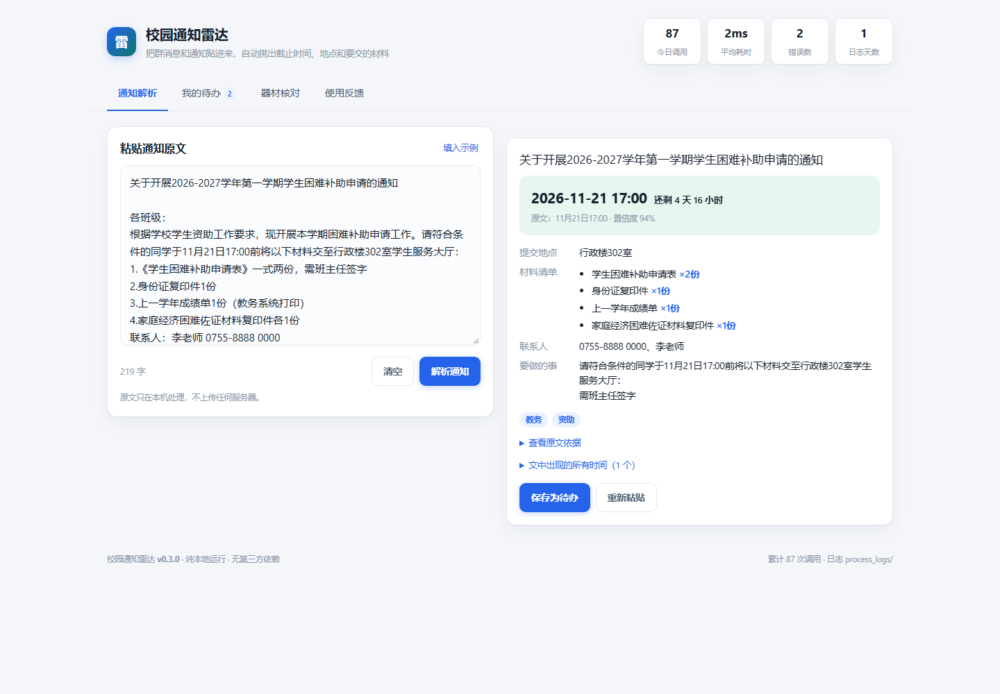
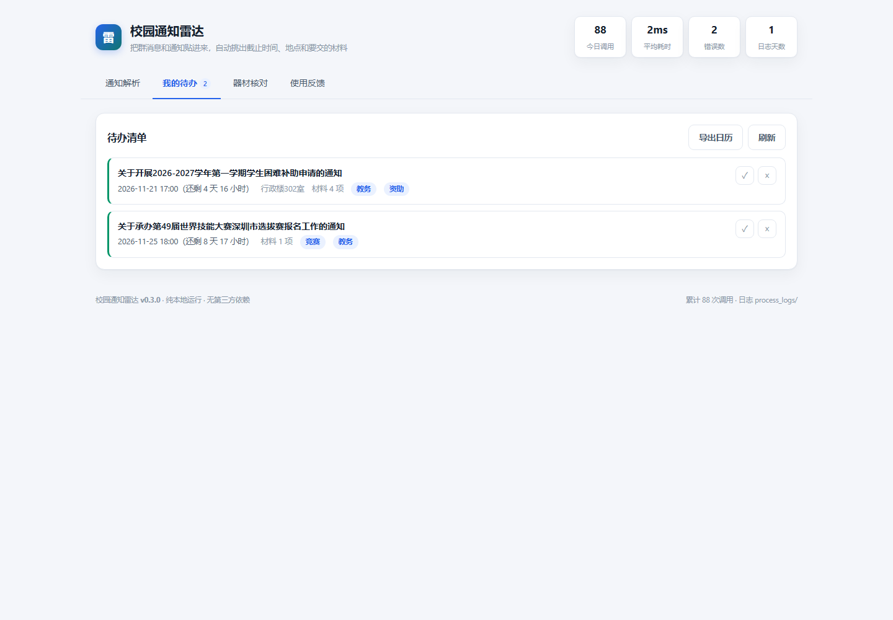
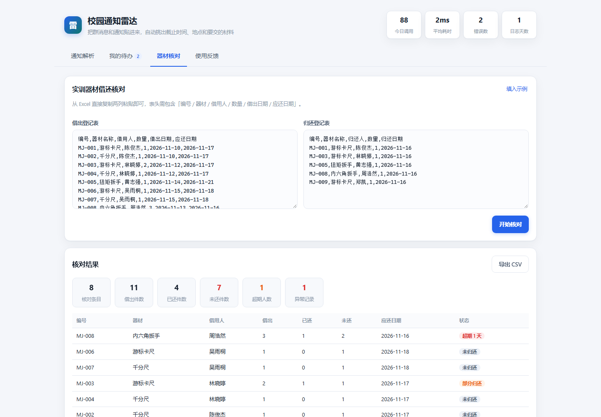

# 校园通知雷达（Campus Notice Radar）

把班级群消息、公众号推文、官网通知粘进来，自动挑出**截止时间、提交地点、要交的材料**，
存成本地待办并导出到手机日历。附带一个实训器材借还核对模块。

面向深圳技师学院的日常场景开发，不装任何第三方库：既可以本机运行（数据不出机器），
也可以发布成在线版（把链接发给同学，他们不用装 Python 就能用）。

**多用户**：每人用学号注册一个账号，登录后只看得到自己的待办与反馈；
管理员（`2024400222`）可以另开一个后台看全局数据。密码存 PBKDF2 哈希，库里没有明文。

> **在线体验**：<https://wbapp-afaouz2pxzdkqew3f4th4r.app.workbuddy.host/?sharecode=YBY6WAHAYJ>

---

## 两种运行模式

| | 本机运行 | 在线版 |
| --- | --- | --- |
| 启动 | `python app.py` | 打开上面的链接 |
| 数据 | 存在自己的硬盘上，长期保留 | 存在沙箱容器里，**环境重建会清空** |
| 隐私 | 通知原文不出本机 | 原文会发到云端处理，仅内存中处理，不落日志 |
| 用途 | 日常自用、产出运行日志 | 给同学试用、收反馈、演示 |
| 监听 | 只绑 `127.0.0.1`，同网段访问不到 | 平台注入 `PORT`，绑 `0.0.0.0` |

同一个代码库，靠环境变量区分：检测到 `PORT` 就走云端模式（绑定地址、资源内联），
否则只监听回环地址。

> 线上版的反馈页在提交后会额外给一段可复制的记录，因为容器重建后数据可能不在了，
> 让提交者能把内容带走、补录到本机 `feedback/responses.jsonl`。

---

## 为什么做这个

技工院校的通知有三个特点，导致漏通知是高频事故：

1. **渠道散**：官网「通知公告」栏目、微信公众号推文、班级微信群、班主任口头通知，四条线并行；
2. **要素埋得深**：截止时间常出现在正文第三段中间（"请于 11 月 21 日 17:00 前将以下材料交至……"），
   材料清单用 1. 2. 3. 编号散落，漏一项就要多跑一趟；
3. **写法不统一**：公文写"11月21日17:00"，群里写"本周五下午四点半"，还有人写"三个工作日内"。

现有的待办 App 要求你自己提炼要素再录入，等于把最费神的活留给自己。
这个小工具做的是**从原文直接抽要素**这一步。

第二个痛点是实训器材。实训室用两张纸质/Excel 表登记借出和归还，班委靠肉眼对名字，
"借了两件只还一件"这类数量差经常被漏掉，等到老师查台账才发现。

---

## 三个功能

### 1. 通知解析

粘贴原文 → 输出结构化结果：

| 字段 | 说明 |
| --- | --- |
| 截止时间 | 支持 `11月21日17:00`、`2026年11月25日（周三）18:00`、`本周五下午4点半`、`三个工作日内` 等写法 |
| 提交地点 | 识别"交至/报送至/在……集合"后面的地点，带房间号 |
| 材料清单 | 按 1. 2. 3. / ① ② ③ 拆条，提取数量（一式两份、2 张） |
| 联系人 | 姓名与电话 |
| 待办动作 | "请于……提交报名表"这类祈使句 |
| 分类标签 | 竞赛 / 教务 / 资助 / 实训 / 活动 / 就业 / 学籍 / 生活 |
| 原文依据 | 每项结果附命中句子，可对照核对 |

解析结果可以一键存为待办，再导出 `.ics` 日历（截止前 2 小时提醒）。

**不静默猜测**：抽不到就明确说"未识别到截止时间"，并把文中所有时间候选列出来让你自己挑。



### 2. 待办清单

按截止时间排序，按剩余时间分色（已逾期 / 24 小时内 / 3 天内 / 正常），勾选完成。



### 3. 器材借还核对

从 Excel 直接复制两张表粘贴进来，按「编号 + 借用人」对齐，输出：

- 每人每件器材的 借出 / 已还 / 未还 数量；
- 超期天数（部分归还会单独标出，不会因为"还过一件"就算结清）；
- 异常：归还表里有、借出表里没有的记录，或多还的记录；
- 一段可以直接粘贴到班级群的催还话术。



---

## 快速开始

```bash
python app.py
```

浏览器会自动打开 `http://127.0.0.1:8765/`。

- 需要 Python 3.9+，**不需要 pip install 任何东西**（只用标准库，含 SQLite）。
- 首次打开是登录页，先点「注册」建账号（密码至少 6 位、需含字母和数字）。
  用 `2024400222` 注册即自动成为管理员，登录后右上角会出现「管理后台」。
- 服务只监听 `127.0.0.1`，手机连不到，通知原文不出本机。
- `python app.py --port 9000 --no-browser` 可指定端口、不自动开浏览器。

每日自动任务：

```bash
python tools/daily_run.py
```

扫 `data/inbox/` 里的新通知 → 解析入待办 → 自检 → 生成 `../process_logs/reports/日期.md` → 更新 `../process_logs/telemetry/summary.csv`。

---

## 运行日志规范

日志是本项目的核心交付物之一，落在**上一级的** `process_logs/`（与 `src/` 平级）：

```
02-20Days-Challenge/process_logs/
├── 2026-11-17.md          人工过程日志（按课程模板写，记卡在哪、怎么绕过去）
├── telemetry/
│   ├── 2026-11-17.jsonl   程序当天全部事件，一行一条
│   ├── 2026-11-18.jsonl
│   └── summary.csv        每日汇总（事件数 / 错误率 / 平均耗时 / P95）
└── reports/
    └── 2026-11-17.md      自动生成的当日指标日报
```

单条记录长这样：

```json
{"ts":"2026-11-17T10:42+08:00","sid":"706ed2","evt":"parse_notice","dur_ms":0.79,
 "ok":true,"meta":{"chars":224,"items":4,"deadline":true,"deadline_conf":0.94,"materials":4}}
```

**脱敏规则**（写在 `core/telemetry.py` 里，靠白名单强制执行，不是靠自觉）：

| 项目 | 处理方式 |
| --- | --- |
| 时间戳 | 精确到分钟，不写毫秒，避免行为指纹 |
| 用户身份 | 只记 6 位随机会话哈希，不可反查 |
| 通知原文 | 一律不入日志，只记字符数 |
| meta 字段 | 白名单过滤，未列出的键直接丢弃 |
| 姓名 / 手机号 / 学号 | 字符串值再过一遍正则脱敏 |
| 错误信息 | 只留异常类型与首行，截断 200 字符 |

记录的事件类型：`app_start`、`app_stop`、`parse_notice`、`check_inventory`、
`auto_parse`、`self_check`、`daily_run_start`、`daily_run_end`、`submit_feedback`、
`export_ics`、`export_inventory`、`complete_task`、`http_error`、`api_error`。

---

## 目录结构

本目录即 `02-20Days-Challenge/src/`，是阶段二的可运行源码：

```
src/
├── app.py                    本地服务入口（标准库 http.server）
├── core/
│   ├── store.py              SQLite 存储（用户 / 会话 / 待办 / 反馈）
│   ├── auth.py               注册登录、密码哈希、会话管理
│   ├── telemetry.py          脱敏日志 + 统计聚合
│   ├── timeparse.py          中文时间表达解析
│   ├── notice_parser.py      通知结构化提取
│   └── inventory.py          器材借还核对
├── web/                      界面（原生 HTML/CSS/JS，白灰蓝）
│   ├── login.html            登录 / 注册
│   ├── index.html            工作台（我的待办）
│   └── admin.html            管理后台（仅管理员）
├── tools/
│   ├── daily_run.py          每日自动任务
│   ├── gen_report.py         多日汇总报告（提交用）
│   ├── export_feedback.py    反馈汇总导出
│   ├── smoke_test.py         端到端冒烟（注册/登录/隔离/越权）
│   └── install_task.ps1      注册 Windows 计划任务
├── tests/
│   ├── eval_parser.py        解析准确率离线评测
│   ├── golden.json           评测标准答案
│   └── test_core.py          单元测试
├── data/
│   ├── samples/              测试语料（模拟通知，非真实用户数据）
│   ├── inbox/                待解析通知投放目录
│   └── tasks.json            待办数据
├── process_logs/             运行日志（见上）
├── feedback/                 用户反馈
└── docs/                     评测记录、用户反馈记录
```

---

## 自动化部署

日志要连续，就不能靠"想起来才打开"。两条路，任选其一或都装：

**Windows 计划任务**（推荐，不依赖任何客户端）

```powershell
powershell -ExecutionPolicy Bypass -File tools\install_task.ps1
```

每天 08:10 与 19:30 各跑一次，关机错过会在开机后补跑。卸载加 `-Uninstall`。

**编辑器内置的定时任务**

已在 WorkBuddy 里注册「校园通知雷达 · 每日运行与日志提交」，每天 19:10 执行
`daily_run.py` 并提交当天日志。

两种方式写的日志格式完全一致，可以混用。

---

## 评测与迭代

`tests/eval_parser.py` 用 8 条固定语料算三项准确率：

```bash
python tests/eval_parser.py
```

每次改解析规则前后都跑一遍，把数字记进 `docs/eval_*.md`。迭代记录见 `CHANGELOG.md`。

---

## 已知限制

- **只处理文本**，不做截图 OCR。公众号可以先全选复制正文再粘贴，多一步但零依赖。
- **不做联网抓取**。学校通知分散在多个系统且需要登录，抓取既不稳定也不合适，改为手动转存 + 自动解析。
- 相对时间（"三个工作日内"）按自然日 + 跳过周末粗算，界面会标注"建议人工复核"。
- 一个通知里有多个截止时间（选课开始/结束、报名截止、材料补交）时，只取最可能的那一个作为主截止，
  其余在"文中出现的所有时间"里列出。
- 材料清单只处理 12 项以内，超出部分截断。

---

## 隐私

- 通知原文、器材表格、反馈内容全部只存本机，代码里没有任何外部请求。
- `data/notes/`（通知原文）已在 `.gitignore` 中排除，不会进仓库。
- 反馈表单不收集姓名和联系方式。
